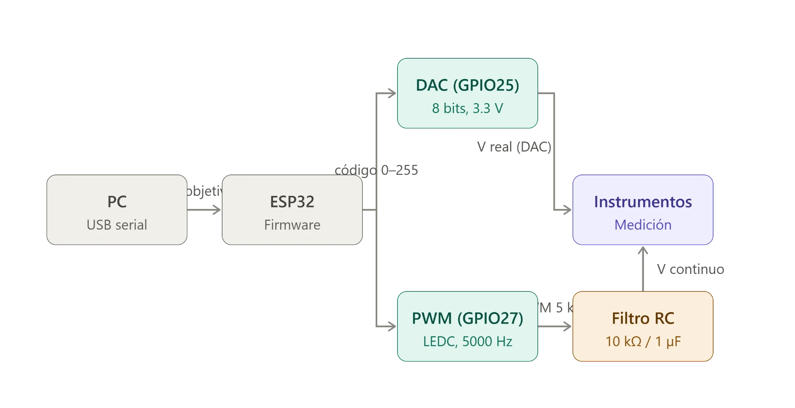

# TEB II – Laboratorio 1: Generación y calibración de una señal analógica con ESP32

Taller de Equipos Biomédicos II · Escuela Profesional de Ingeniería Biomédica · UNMSM

Se genera un voltaje programado con un ESP32 por dos métodos, el **DAC de 8 bits** (GPIO25) y un **PWM filtrado con RC pasabajos** (GPIO27), y se compara cada uno contra lo que mide el multímetro para construir sus curvas de calibración.

## Objetivos

- Programar un voltaje en el DAC y verificar con osciloscopio y multímetro si coincide con el valor real.
- Generar el mismo voltaje por PWM y diseñar el filtro RC que lo reconstruye como señal continua.
- Determinar el error y la resolución efectiva de cada método.
- Construir la curva de calibración voltaje programado – voltaje medido.

## Fundamento en breve

| Concepto | Expresión | Valor en este laboratorio |
|---|---|---|
| Resolución del DAC de n bits | ΔV = Vref / (2ⁿ − 1) | 3.3 V / 255 ≈ **12.9 mV** por escalón |
| Valor promedio del PWM | V̄ = D · VDD | D = código / 255 |
| Frecuencia de corte del filtro RC | fc = 1 / (2πRC) | R = 10 kΩ, C = 1 µF → **≈ 15.9 Hz** |
| Error porcentual | (V_medido − V_prog) / V_prog · 100 | por punto y por método |

**Por qué funciona el filtro.** El PWM es una onda cuadrada de 5000 Hz cuyo valor *promedio* es proporcional al ciclo de trabajo. Con fc ≈ 15.9 Hz, más de dos décadas por debajo de la portadora, el filtro deja pasar ese promedio (componente continua) y atenúa fuertemente la conmutación, dejando un rizado del orden de 0.3 % de la amplitud. Un rizado mayor indica que la frecuencia configurada o el montaje del filtro no corresponden a lo especificado.

**Por qué hay diferencia entre métodos.** El DAC entrega el nivel directamente con resolución de 8 bits; el PWM filtrado depende además del rizado residual, de la tolerancia de R y C, de la impedancia de carga del multímetro sobre el filtro y de la precisión del ciclo de trabajo, así que se espera mayor error en el PWM. Cualquier diferencia menor a ≈ 12.9 mV no es un error del sistema, sino el límite físico de la cuantización.

## Estructura del repositorio

```
firmware/lab1_dac_pwm/lab1_dac_pwm.ino   Sketch de Arduino para el ESP32
data/tabla1_calibracion.csv              Tabla 1 (datos medidos)
analysis.py                              Errores, sensibilidad y curva de calibración
hardware/kicad/                          Proyecto KiCad 10 (esquemático editable)
docs/esquematico_labo1.pdf               Esquemático exportado (etapas 1–3)
docs/diagrama_bloques.png                Diagrama de bloques del sistema
docs/curva_calibracion.png               Curva de calibración (la genera analysis.py)
```

## Diagrama de bloques



El PC envía el voltaje objetivo por USB serial; el firmware lo convierte a un código 0–255 que se entrega en paralelo al DAC (GPIO25) y al PWM LEDC de 5000 Hz (GPIO27). El PWM pasa por el filtro RC para obtener un voltaje continuo, y ambas salidas se miden con los instrumentos.

## Circuito

| Conexión | Descripción |
|---|---|
| GPIO25 → nodo D | Salida DAC (medir directo, sin componentes) |
| GPIO27 → R 10 kΩ → nodo filtrado | Salida PWM |
| Nodo filtrado → C 1 µF → GND | Capacitor del filtro RC |
| GND del ESP32 | Referencia común de multímetro y osciloscopio |

Materiales: ESP32, cable USB, resistencia 10 kΩ, capacitor cerámico 1 µF, protoboard, jumpers, osciloscopio y multímetro digital.

El esquemático completo está en [`docs/esquematico_labo1.pdf`](docs/esquematico_labo1.pdf) (fuente editable en [`hardware/kicad/`](hardware/kicad/)) y se divide en tres etapas:

| Etapa | Contenido |
|---|---|
| 1 | ESP32 con las salidas crudas: nodo D (GPIO25, DAC) y nodo P (GPIO27, PWM) |
| 2 | Filtro RC en GPIO27 (R serie 10 kΩ, C a GND) → PWM acondicionado en el nodo filtrado |
| 3 | Montaje de medición: DAC crudo y PWM acondicionado llevados al multímetro |

## Firmware

El programa cumple los requisitos de la guía: lee un voltaje (0–3.3 V) por el Monitor Serial, lo limita al rango válido, lo convierte a un código de 8 bits y lo entrega por el DAC (GPIO25) y por PWM LEDC (GPIO27, 5000 Hz, 8 bits, `ledcAttach(27, 5000, 8)`) con la misma escala 0–255. Muestra en el Monitor Serial el voltaje ingresado y el código calculado.

- Requiere el core **Arduino-ESP32 3.x** (API `ledcAttach`).
- Monitor Serial a **115200 baudios**, terminación *Nueva línea*.

## Procedimiento

1. **Verificación inicial.** Cargar el sketch, conectar GPIO25 al osciloscopio y enviar 1.65 V (mitad de escala). Luego observar GPIO27 sin filtro: debe verse una onda cuadrada.
2. **Acondicionar el PWM.** Armar el filtro RC (R serie en la línea PWM, C del nodo a tierra) y verificar en el osciloscopio que el rizado sea pequeño.
3. **Medición.** Enviar voltajes de 0 a 3.3 V (cada 0.5 V), medir con el multímetro en el nodo D y en el nodo filtrado, y registrar en `data/tabla1_calibracion.csv`.

## Análisis

```bash
pip install numpy matplotlib
python analysis.py
```

Calcula el error porcentual por punto, la sensibilidad y el offset de cada salida por regresión lineal, y guarda la curva de calibración en `docs/curva_calibracion.png`.

## Resultados

*(Pendiente: se completará con las mediciones reales de la Tabla 1.)*

## Referencias

- Aston, R. (1990). *Principles of Biomedical Instrumentation and Measurement*. Merrill Publishing Company.
- Cromwell, L., Weibell, F. J., & Pfeiffer, E. A. (1980). *Biomedical Instrumentation and Measurements* (2.ª ed.). Prentice-Hall.
- Khandpur, R. S. (2014). *Handbook of Biomedical Instrumentation* (3.ª ed.). McGraw Hill Education.
- Sedra, A. S., & Smith, K. C. (2020). *Microelectronic Circuits* (8.ª ed.). Oxford University Press.
- Webster, J. G., & Nimunkar, A. J. (2020). *Medical Instrumentation: Application and Design* (5.ª ed.). John Wiley & Sons.
- Espressif Systems. *ESP32 Technical Reference Manual* – capítulo del DAC.
- Espressif Systems. *Arduino-ESP32 – LED Control (LEDC) API Reference*. https://docs.espressif.com/projects/arduino-esp32/en/latest/api/ledc.html
